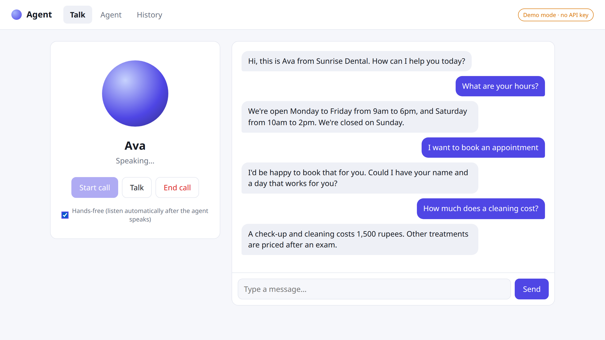

# Agent: a browser voice AI receptionist

Talk to an AI receptionist out loud, right in your browser. It listens, thinks with **Google Gemini**, and answers in a natural voice. You can change its personality and knowledge from the UI, and every conversation is saved with a full transcript.



The default persona is **Ava**, the receptionist for a dental clinic. She answers questions about hours, prices and location, books appointments, and handles emergencies safely. To turn her into a receptionist for any other business, edit the prompt in the **Agent** tab.

## Features

- **Voice conversation.** Speech-to-text and text-to-speech run in the browser. Hands-free mode starts listening again after each reply, and you can interrupt the agent mid-sentence.
- **Gemini-powered.** Uses the Gemini API (`gemini-2.5-flash` by default). The current date and time are added to every request, so the agent can say things like "tomorrow" correctly.
- **Configurable agent.** Change the name, greeting, system prompt and voice without touching code.
- **Conversation history.** Every call is stored in SQLite and can be reviewed or deleted.
- **Demo mode.** With no API key, the agent gives canned replies, so the UI can be shown anywhere.
- **Text fallback.** You can type instead of speaking, and it works in browsers without speech recognition.

## Quick start

Requires Python 3.10+. For voice input, use Chrome or Edge.

```bash
git clone https://github.com/Sheik-Rizwan/agent.git
cd agent
python3 -m venv .venv
source .venv/bin/activate          # Windows: .venv\Scripts\activate
pip install -r requirements.txt

cp .env.example .env               # then paste your key into GEMINI_API_KEY
uvicorn app.main:app --reload --port 8000
```

Open http://localhost:8000, press **Start call**, and allow microphone access.

Get a free Gemini API key at https://aistudio.google.com/apikey. If you leave `GEMINI_API_KEY` empty, the app runs in demo mode.

## Configuration (`.env`)

| Variable | Default | Purpose |
|---|---|---|
| `GEMINI_API_KEY` | *(empty = demo mode)* | Your Gemini API key |
| `GEMINI_MODEL` | `gemini-2.5-flash` | Any Gemini model that supports `generateContent` |
| `AGENT_TIMEZONE` | `Asia/Kolkata` | Time zone for the date and time given to the agent |
| `DATABASE_PATH` | `data/agent.db` | SQLite file for settings and transcripts |

## How it works

```
Browser (app/static)                     FastAPI (app/)                 Google
┌─────────────────────────┐   REST    ┌──────────────────────┐  HTTPS  ┌────────┐
│ Mic → SpeechRecognition │ ────────▶ │ main.py   API routes │ ──────▶ │ Gemini │
│ Transcript UI           │           │ llm.py    Gemini call│ ◀────── │  API   │
│ speechSynthesis → audio │ ◀──────── │ store.py  SQLite     │         └────────┘
└─────────────────────────┘           └──────────────────────┘
```

1. The browser turns your speech into text and sends it to `POST /api/conversations/{id}/messages`.
2. The server stores the message and sends the system prompt plus the recent history to Gemini.
3. The reply is saved, returned and spoken aloud. In hands-free mode, the mic reopens for your next turn.

### API

| Method | Path | Description |
|---|---|---|
| GET | `/api/health` | Status, mode (`gemini`/`demo`) and model |
| GET / PUT | `/api/settings` | Read or update the agent name, greeting and prompt |
| POST | `/api/settings/reset` | Restore the default agent |
| POST | `/api/conversations` | Start a call and return the greeting |
| POST | `/api/conversations/{id}/messages` | Send a caller message and get the reply |
| POST | `/api/conversations/{id}/end` | Mark a call as ended |
| GET | `/api/conversations` | List calls |
| GET / DELETE | `/api/conversations/{id}` | Get or delete a transcript |

## Tests

```bash
pip install -r requirements-dev.txt
pytest
```

The tests cover the full API in demo mode. They also check the Gemini request format and error handling using a mocked HTTP transport, so no key is needed.

## Roadmap

- Real phone calls through Twilio Media Streams
- Lower latency with the Gemini Live API (streaming audio)
- Tool calling for real calendar booking (Google Calendar)
