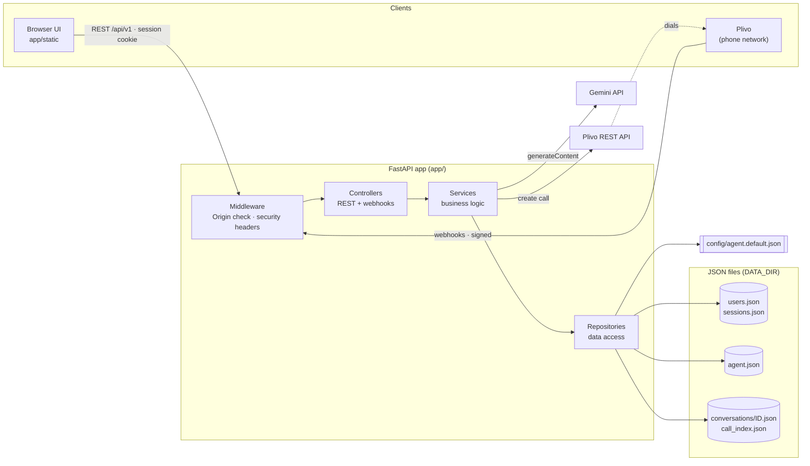

# Architecture

> Interactive version: open [`docs/diagrams/01-system-architecture.html`](diagrams/01-system-architecture.html) in a browser (pan, zoom, search, dark mode, export).

## The big picture



## Layers

Every request passes through the same four layers. Each layer only talks to the one below it.

| Layer | Folder | Responsibility | Never does |
|---|---|---|---|
| **Middleware** | `app/main.py` | Blocks cross-origin writes; adds security headers (CSP, no-sniff, frame-deny, no-store) | Business logic |
| **Controllers** | `app/controllers/` | HTTP only: parse the request, call **one** service, shape the response. Declares who may call it (`get_current_user`, `require_admin`, Plivo signature) | Touch files, call Gemini/Plivo directly |
| **Services** | `app/services/` | The rules: validation, permissions that depend on data (e.g. "not the last admin"), conversation flow, calling Gemini and Plivo | Know about HTTP requests/responses |
| **Repositories** | `app/repositories/` | Read and write JSON files through `core/json_store.py` | Make decisions |

Wiring happens in `app/dependencies.py` with FastAPI's `Depends`, so every request gets fresh service objects built from the current config, and tests can swap anything.

```
app/
├── main.py                  app, middleware, error handler, startup (bootstrap admin)
├── dependencies.py          repositories → services → controllers; auth guards
├── schemas.py               request/response models (Pydantic)
├── cli.py                   user management from the terminal
├── core/
│   ├── config.py            every setting, from environment variables
│   ├── json_store.py        atomic, locked JSON file storage
│   ├── security.py          scrypt password hashing, session tokens
│   └── exceptions.py        domain errors → HTTP status codes
├── controllers/             health, auth, users, agent, conversations, calls, plivo webhooks
├── services/                auth, user, agent, conversation, llm (Gemini), plivo
├── repositories/            user, session, agent, conversation
└── static/                  index.html, app.js, styles.css (no build step)
```

## Data: JSON files

All data lives in plain JSON under `DATA_DIR` (default `data/`, ignored by git). You can open any file and read it.

| File | Contents | Written by |
|---|---|---|
| `users.json` | `{"users": {"<username>": {role, password_hash, created_at, created_by, last_login_at}}}` | `UserRepository` |
| `sessions.json` | `{"sessions": {"<sha256 of token>": {username, created_at, expires_at}}}` | `SessionRepository` |
| `agent.json` | Only the agent fields an admin changed in the UI | `AgentRepository` |
| `conversations/<id>.json` | One conversation: channel, who/which number, timestamps, and every message | `ConversationRepository` |
| `call_index.json` | `{"<Plivo CallUUID>": "<conversation id>"}` | `ConversationRepository` |

`config/agent.default.json` (in git) holds the default persona, the phone phrases and the demo-mode replies. Its `agent` keys *define* the agent fields: add a key there and it appears in the API and as a field in the Agent tab.

**How the JSON store stays safe** (`app/core/json_store.py`):
- **Atomic writes:** write to a temp file, `fsync`, then rename over the original. A crash can't leave half a file.
- **No lost updates:** every read-modify-write holds a per-file thread lock plus an OS file lock (`fcntl`).
- **Private:** files are `0600` in a `0700` folder.
- **Self-healing:** a corrupt file is moved to `<name>.corrupt-<timestamp>` and a fresh one is started, with an error in the log.
- **No path tricks:** conversation ids must match `^[0-9a-f]{32}$` before they become a filename.

Limits: designed for one server process and up to thousands of conversations. For more, swap the repositories for a database. Nothing above the repository layer needs to change.

## Security model

| Threat | Defence | Where |
|---|---|---|
| Stolen `users.json` | scrypt hashes (16 MB memory cost) with random salts | `core/security.py` |
| Stolen `sessions.json` | Only SHA-256 hashes of tokens are stored | `core/security.py`, `SessionRepository` |
| Password guessing | 5 failures per username+IP → locked for 15 min (HTTP 429) | `AuthService` |
| Username probing | Unknown users are checked against a dummy hash (same timing, same error) | `AuthService.login` |
| Weak passwords | ≥10 chars, a letter and a digit, must not contain the username | `UserService.validate_password` |
| Cookie theft via JavaScript | Cookie is `HttpOnly`; `Secure` when `COOKIE_SECURE=true` | `auth_controller` |
| CSRF | Cookie is `SameSite=Strict` **and** cross-origin writes are rejected by Origin check | `main.py` middleware |
| XSS | Strict Content-Security-Policy (`script-src 'self'`, no inline); UI uses `textContent` only | `main.py`, `app.js` |
| Clickjacking | `X-Frame-Options: DENY`, `frame-ancestors 'none'` | `main.py` |
| Fake Plivo webhooks | HMAC-SHA256 signature (`X-Plivo-Signature-V2`) checked with your auth token | `plivo_webhook_controller` |
| Privilege escalation | Admin-only routes use `require_admin`; can't delete yourself or the last admin | controllers, `UserService` |
| Stale access | Deleting a user or resetting their password logs them out everywhere | `UserService` |
| Path traversal | Ids validated before use as filenames | `ConversationRepository` |
| Secrets in git | `.env` and `data/` are git-ignored | `.gitignore` |

### Roles

| Can… | `user` | `admin` |
|---|:-:|:-:|
| Talk to the agent, place phone calls, read history | ✅ | ✅ |
| View the agent configuration | ✅ | ✅ |
| Change own password | ✅ | ✅ |
| Edit or reset the agent configuration | | ✅ |
| Delete conversations | | ✅ |
| Create users, delete users, reset passwords | | ✅ |
