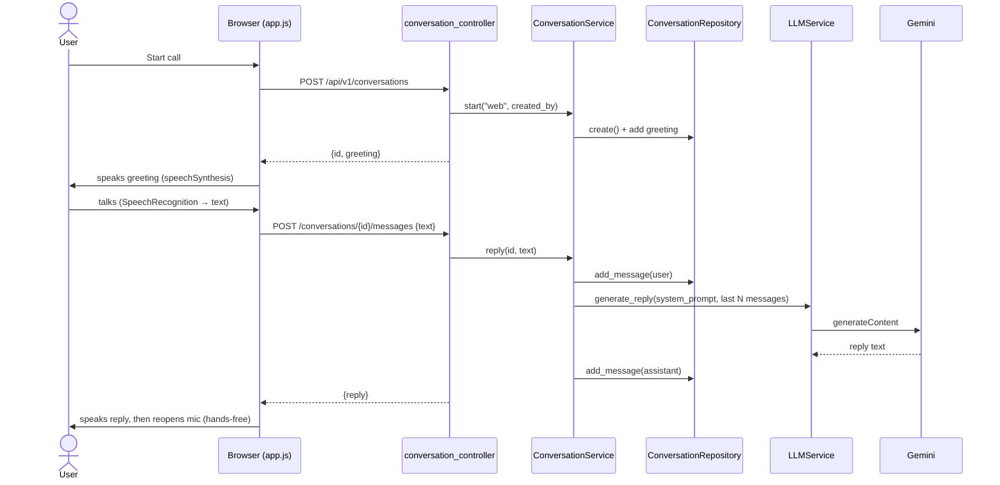
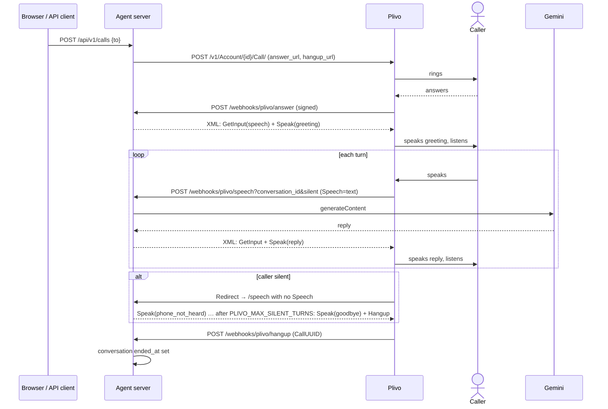
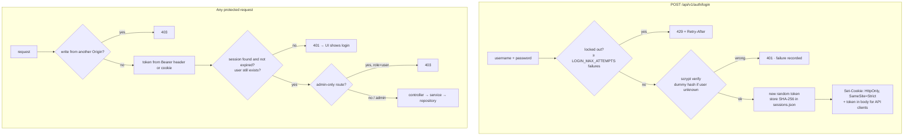
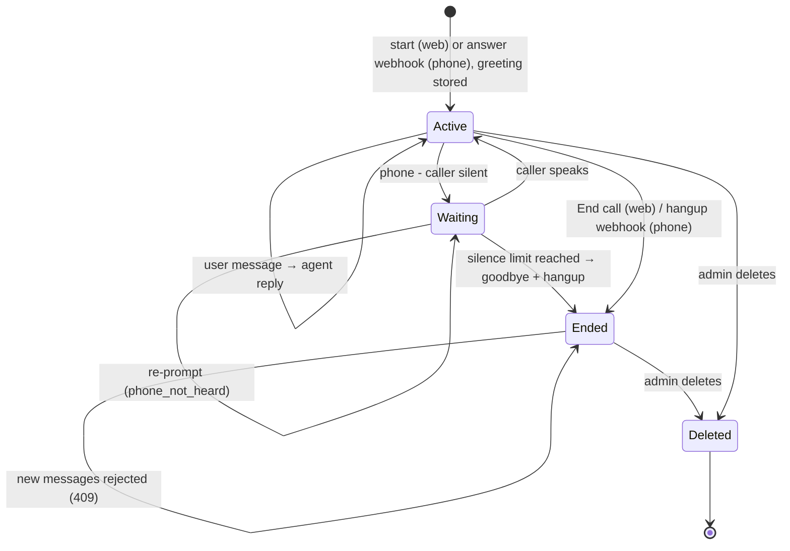
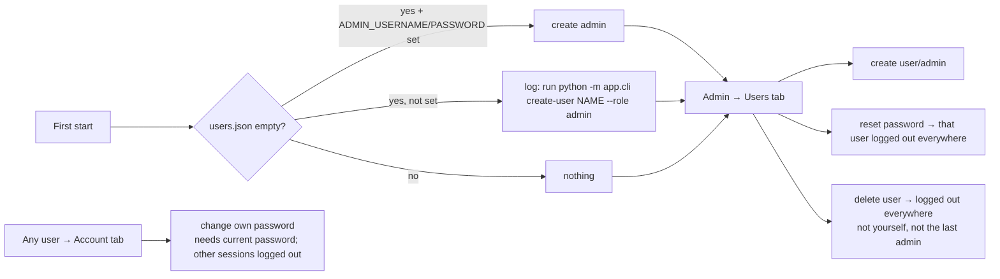
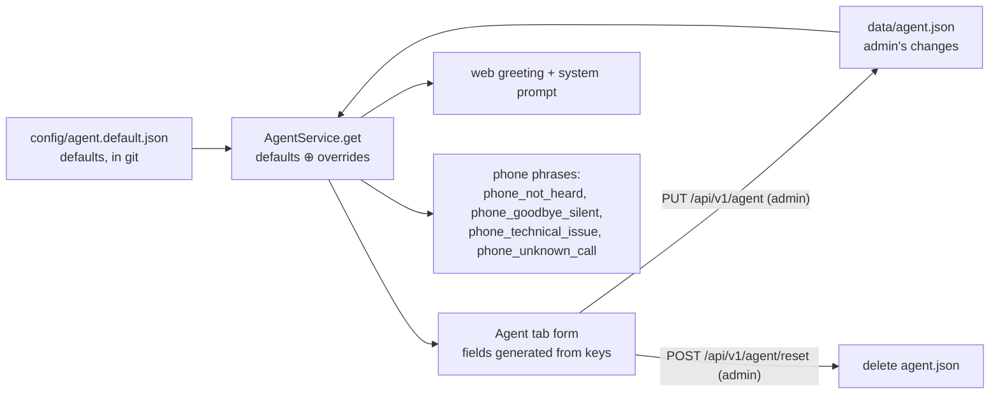

# Workflows

Step-by-step flows through the code, with the file and function for each step. Interactive versions of each diagram are in [`docs/diagrams/`](diagrams/).

1. [Web voice conversation](#1-web-voice-conversation)
2. [Phone call with Plivo](#2-phone-call-with-plivo)
3. [Login and every authenticated request](#3-login-and-every-authenticated-request)
4. [Conversation lifecycle](#4-conversation-lifecycle)
5. [User management](#5-user-management)
6. [Changing the agent](#6-changing-the-agent)

---

## 1. Web voice conversation

> Interactive: [`diagrams/02-web-voice-conversation.html`](diagrams/02-web-voice-conversation.html)



| Step | Code |
|---|---|
| Mic → text, text → speech, hands-free loop, interrupting | `app/static/app.js`: `startListening`, `speak`, `afterAgentTurn` |
| Stale callbacks ignored when you interrupt or end the call | `app.js`: `state.turn` counter |
| Start, reply, end | `ConversationService.start / reply / end` |
| History trimmed to `LLM_MAX_HISTORY_MESSAGES` | `ConversationService.reply` |
| Date and time added to the prompt | `LLMService._clock_context` |
| No API key → keyword replies from `config/agent.default.json` | `LLMService.demo_reply` |
| Gemini fails → HTTP 502 with the reason | `LLMService.generate_reply` → `UpstreamError` |

---

## 2. Phone call with Plivo

> Interactive: [`diagrams/03-phone-call-plivo.html`](diagrams/03-phone-call-plivo.html)



| Step | Code |
|---|---|
| Place the call (REST) | `call_controller.place_call` → `PlivoService.place_call` |
| Phone number check (8–15 digits) | `plivo_service.normalize_number` |
| Every webhook's signature verified | `plivo_webhook_controller.verify_plivo_signature` |
| Answer: create the phone conversation (retries reuse it) | `plivo_webhook_controller.answer` |
| Build Plivo XML (escaped safely) | `PlivoService.listen_xml / hangup_xml` |
| Silence counting via the `silent` query parameter | `plivo_webhook_controller.speech` |
| Gemini fails mid-call → speak `phone_technical_issue`, keep listening | `plivo_webhook_controller.speech` |
| Inbound calls | Point your Plivo number's answer URL at `/api/v1/webhooks/plivo/answer` |

---

## 3. Login and every authenticated request

> Interactive: [`diagrams/04-auth-and-access.html`](diagrams/04-auth-and-access.html)



| Step | Code |
|---|---|
| Origin check, security headers | `app/main.py`: `security_middleware` |
| Rate limiting | `auth_service.LoginRateLimiter` |
| Password check | `core/security.verify_password` |
| Session create, validate, expire | `AuthService.login / authenticate`, `SessionRepository` |
| Guards | `dependencies.get_current_user`, `dependencies.require_admin` |
| Logout (server-side session deleted) | `auth_controller.logout` |
| UI: any 401 → login screen | `app.js`: `api()` → `showLogin` |

---

## 4. Conversation lifecycle

> Interactive: [`diagrams/05-conversation-lifecycle.html`](diagrams/05-conversation-lifecycle.html)



---

## 5. User management



The same actions exist on the command line (works while the server is stopped):

```bash
python -m app.cli create-user alice --role admin
python -m app.cli list-users
python -m app.cli reset-password alice
python -m app.cli delete-user alice
```

---

## 6. Changing the agent



- **Change the default persona for everyone:** edit `config/agent.default.json`.
- **Change it for this deployment only:** use the Agent tab. That writes `data/agent.json`.
- **Add a new field:** add a key under `agent` in the defaults file. It shows up in the API and the UI with no code change. Required keys: `agent_name`, `greeting`, `system_prompt`, and the four `phone_*` phrases.
- **Change demo-mode answers:** edit the `demo.replies` keyword list in the same file.
