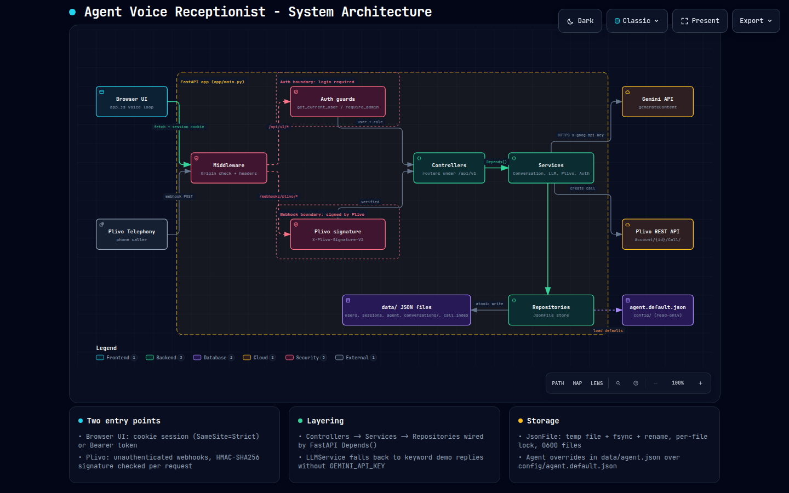
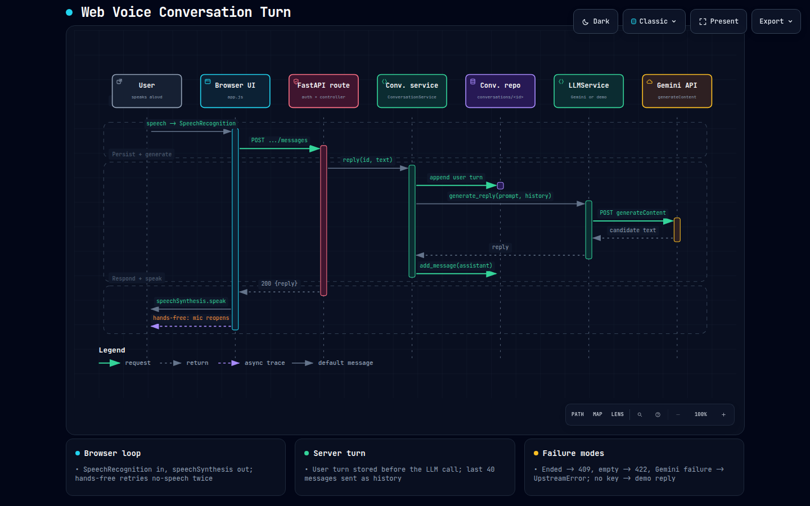
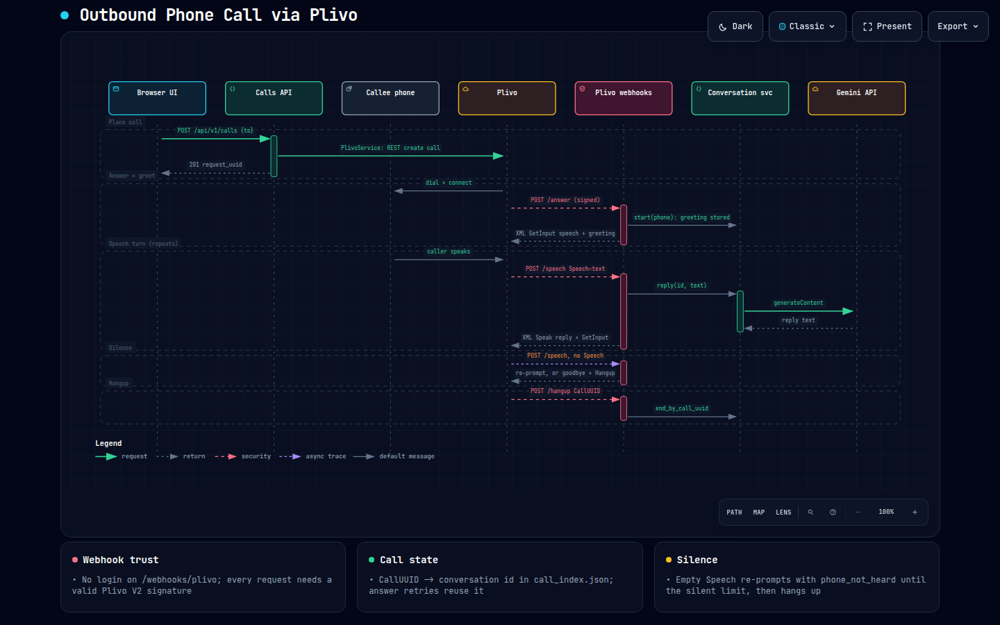
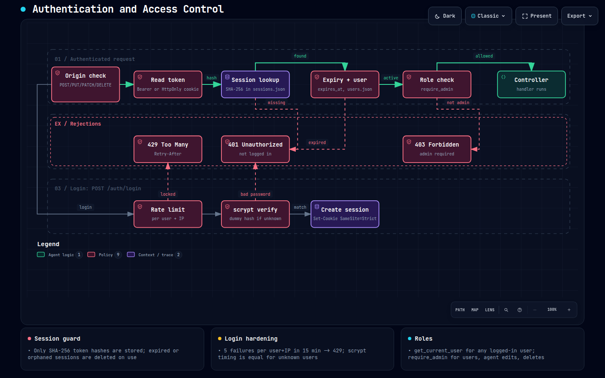
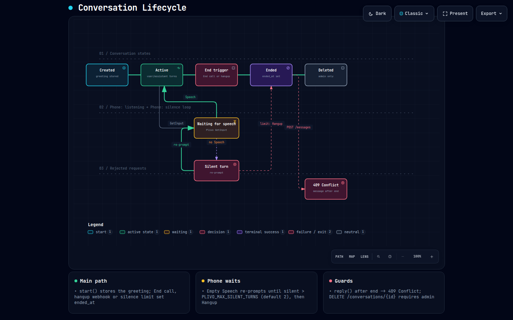

# Diagrams

Interactive diagrams of how Agent works, generated with [archify](https://github.com/tt-a1i/archify) from the JSON specs in [`specs/`](specs/).

**To explore one:** download or clone the repo, then open the `.html` file in a browser. You can pan, zoom, search, trace a path, switch between light and dark, present, and export to PNG, SVG or WebM. GitHub only shows the HTML source, so a preview of each is below.

| # | Diagram | Type | What it shows |
|---|---|---|---|
| 1 | [System architecture](01-system-architecture.html) | architecture | Entry points, the auth and webhook security boundaries, the layers, JSON storage, Gemini and Plivo |
| 2 | [Web voice conversation](02-web-voice-conversation.html) | sequence | One spoken turn in the browser, from mic to Gemini and back to speech |
| 3 | [Phone call with Plivo](03-phone-call-plivo.html) | sequence | Placing a call, the answer/speech/hangup webhooks, silence handling |
| 4 | [Auth and access](04-auth-and-access.html) | workflow | Login (rate limit, scrypt, session) and the checks on every request |
| 5 | [Conversation lifecycle](05-conversation-lifecycle.html) | lifecycle | Created → active → (silent) → ended → deleted |

The written walk-throughs, mapped to the code, are in [`../WORKFLOWS.md`](../WORKFLOWS.md) and [`../ARCHITECTURE.md`](../ARCHITECTURE.md).

## 1. System architecture


## 2. Web voice conversation


## 3. Phone call with Plivo


## 4. Auth and access


## 5. Conversation lifecycle


## Regenerating

After changing a spec in `specs/`, re-render it with archify:

```bash
cd ~/.agents/skills/archify
node bin/archify.mjs deliver <type> /path/to/agent/docs/diagrams/specs/<name>.json \
     /path/to/agent/docs/diagrams/<name>.html --quality showcase
```
